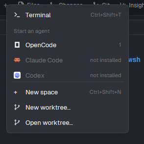

# WSL New Menu

A clone of Herdr's tab-bar **+** menu. In a WSL space, it starts terminals and coding agents in that same distro, shows agents installed there first, and marks the remaining known agents as not installed.

## What you see

The standard **Terminal**, **Start an agent**, **New space**, and worktree actions. The menu does not list distros; they are managed by the separate WSL Manager. In a WSL space, installed agents have number shortcuts, followed by disabled **not installed** rows.

## How it behaves

- In a normal Windows or SSH space, Terminal and agents use Herdr's standard launch behavior.
- In a local WSL space, **Terminal** opens a shell in the same distro and uses the active Linux working directory when available.
- Agents launch through `wsl.exe` and a Bash login shell, with the WSL agent directories ahead of Windows-mounted PATH entries.
- The mod checks the first executable in each known agent's launch command inside the active distro. Paths under `/mnt` and `.exe` binaries are excluded.
- The detected command list is cached per distro in Herdr shared state for five minutes. Installed agents appear first; remaining known agents are disabled and marked **not installed**.

## Built from

`main.js` clones Herdr's `new-menu` mod. It uses `knownAgents`, `exec`, `spaces`, `panes`, `shared`, `setShared`, and `run("tab.new")`. WSL detection uses the `wsl.spaces` mapping from `spaces-wsl` and the `WSL ? <distro>` name prefix as a fallback.

## Watch out

Windows agent installations are not treated as Linux installations. Install an agent inside the distro to run it there; authentication and provider configuration are separate per WSL user. The check recognizes Herdr's known agent catalog and first command only. The menu expects `bash` inside WSL. It is intended to be installed with `spaces-wsl` and `wsl-manager` through `setup.ps1`.

## Done when

- WSL agent inventory is checked once per cache period and shown in the menu.
- An installed Linux agent opens in the current WSL distro and directory.
- A missing agent is visible but cannot be launched.
- `herdr-app check mods/new-menu-wsl` passes.
