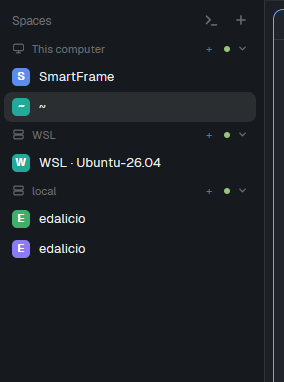

# WSL Spaces Sidebar

A clone of Herdr's Spaces sidebar that keeps local WSL spaces under a separate **WSL** heading, even after their names change, and adds a button to open the WSL Manager.

## What you see

The normal Herdr Spaces list remains grouped by machine. Local WSL spaces appear under their own **WSL** header, with the same selectable space rows and collapse control used by machine groups. A terminal icon beside **Spaces** opens the WSL Manager; the normal **+** still creates a regular Herdr space.

## How it behaves

- Spaces named `WSL ? <distro>` are grouped under **WSL**.
- A shared ID-to-distro map preserves grouping after a user renames a space. On startup, the mod can also recover associations from installed distro names.
- The **WSL** heading has its own fold state. Its **+** creates another space for the first distro in that group.
- Clicking the terminal icon beside **Spaces** opens `wsl-manager`.
- Other machine groups, Git summaries, worktree ordering, and normal space selection continue to follow the cloned Herdr Spaces mod.

## Built from

`main.js` clones Herdr's `spaces` mod and adds local WSL membership, a shared `wsl.spaces` map, the WSL group, and the manager launcher. It uses `exec` to list WSL distros, `setShared` to retain renamed-space associations, `openOverlay` to show the manager, and `run("space.new")` for local WSL spaces.

The companion `wsl-manager` and `new-menu-wsl` mods are installed by the repository's `setup.ps1`.

## Watch out

This mod targets Windows and requires `wsl.exe`. Distro-name matching is used to recover older renamed spaces when no stored association exists; a regular space with exactly the same name as an installed distro may be recognized as WSL. The manager button requires `wsl-manager` to be installed.

## Done when

- Local WSL spaces appear under **WSL** rather than the Windows or SSH machine group.
- Renaming a mapped WSL space does not move it out of the WSL group.
- The terminal icon opens the WSL Manager.
- `herdr-app check mods/spaces-wsl` passes.
