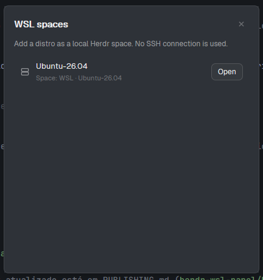

# WSL Manager

A native Herdr dialog that lists the installed WSL distributions and lets you add one as a local Herdr space or open its existing space. It uses `wsl.exe` directly and does not create SSH connections.

## What you see

A compact dialog titled **WSL spaces**. Each row shows a distribution name, whether it already has a Herdr space, and an **Add WSL** or **Open** button. Docker's internal distributions are omitted. If WSL is unavailable or has no user distributions, the dialog shows an empty-state message.

## How it behaves

- **Add WSL** creates a local space named `WSL ? <distro>` and launches `wsl.exe -d <distro> --cd ~`.
- If that distro already has a local WSL space, the button changes to **Open** and selects that space.
- The close button dismisses the dialog.

## Built from

`main.js` is a Herdr mod using `exec`, `spaces`, `run`, `shared`, `theme`, and overlay close commands. It reads `wsl.exe --list --quiet`, creates spaces with `space.new`, and opens an existing one with `space.select`. The server icon comes from Herdr's `workspace-chrome` assets.

The coordinated installer places this mod in `mods/wsl-manager`. The **Spaces** header button supplied by `spaces-wsl` opens it.

## Watch out

This mod is for Herdr on Windows with WSL and Bash installed. It hides `docker-desktop` and `docker-desktop-data`. It creates local spaces, not Herdr SSH machines. If a space is renamed, the companion `spaces-wsl` mod retains the distro association.

## Done when

- The dialog lists installed non-Docker WSL distributions.
- **Add WSL** creates a local space whose terminal starts in the selected distro.
- **Open** selects the existing space for that distro.
- `herdr-app check mods/wsl-manager` passes.
